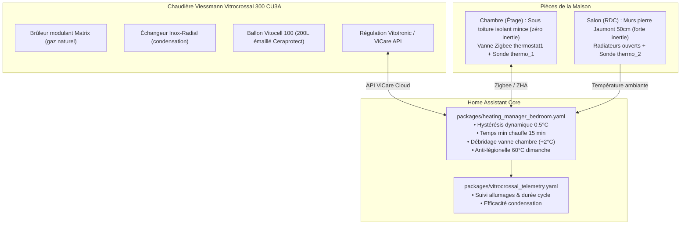
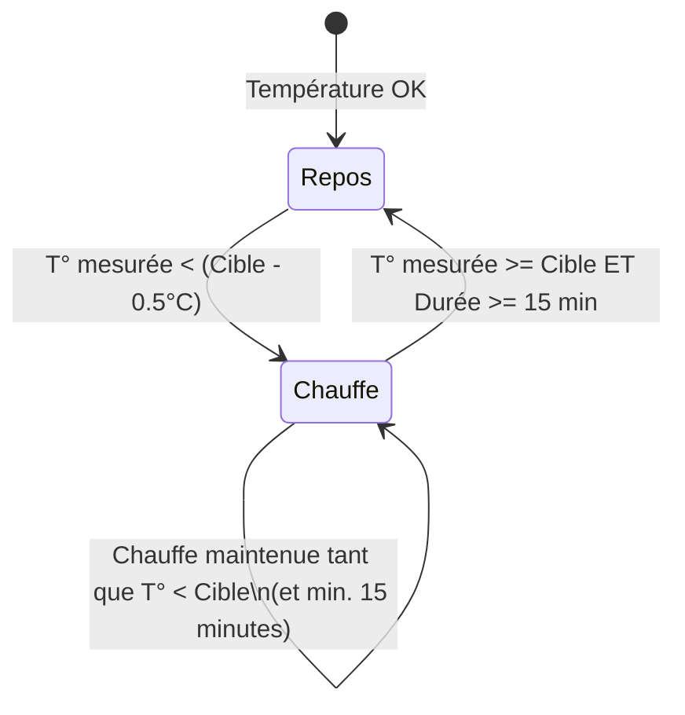

# 📖 Documentation Complète du Système de Chauffage & Eau Chaude Sanitaire

> **Chaudière :** Viessmann Vitrocrossal 300 CU3A (Gaz à condensation au sol)  
> **Gestionnaire domotique :** Home Assistant 2024+  
> **Intégration :** ViCare (API Cloud Viessmann) & Zigbee (Vanne thermostatique)  
> **Dernière mise à jour :** Octobre 2026

---

## Table des Matières
1. [Architecture Globale & Matérielle](#1-architecture-globale--matérielle)
2. [Caractéristiques Thermiques du Bâtiment (Enveloppe & Inertie)](#2-caractéristiques-thermiques-du-bâtiment-enveloppe--inertie)
3. [Loi d'Eau & Rendement de Condensation](#3-loi-deau--rendement-de-condensation)
4. [Algorithme de Régulation du Chauffage](#4-algorithme-de-régulation-du-chauffage)
5. [Gestion de la Vanne Connectée & Anti-Étranglement](#5-gestion-de-la-vanne-connectée--anti-étranglement)
6. [Eau Chaude Sanitaire (ECS) & Anti-Légionelle](#6-eau-chaude-sanitaire-ecs--anti-légionelle)
7. [Détection d'Aération Sécurisée](#7-détection-daération-sécurisée)
8. [Télémétrie, Alertes & Anti-Court-Cycle](#8-télémétrie-alertes--anti-court-cycle)
9. [Cartographie des Entités & Fichiers de Configuration](#9-cartographie-des-entités--fichiers-de-configuration)

---

## 1. Architecture Globale & Matérielle



### Caractéristiques physiques :
- **Chaudière :** Viessmann Vitrocrossal 300 CU3A avec brûleur hémisphérique Matrix (puissance modulante ~4 à 19 kW).
- **Préparateur ECS :** Viessmann Vitocell 100 vertical de **200 Litres** (cuve en acier émaillé Ceraprotect, isolation thermique intégrale en mousse rigide de polyuréthane, serpentin de chauffe interne plongeant jusqu'au fond).
- **Mode ViCare de veille :** `dhw` (Eau Chaude Sanitaire seule). Quand aucune pièce ne demande de chauffage, la chaudière bascule en `dhw` : le circulateur de chauffage s'arrête, évitant les pertes d'énergie électrique et la déperdition thermique dans les tuyaux.
- **Mode ViCare de chauffe :** `forcedNormal` (Chauffage actif + ECS).
- **Quotas Cloud ViCare :** Viessmann impose une limite de ~1450 requêtes/jour. Le système intègre des filtres anti-rebond stricts (temporisation minimum de 10 à 15 minutes entre changements de mode) pour ne pas saturer l'API.

---

## 2. Caractéristiques Thermiques du Bâtiment (Enveloppe & Inertie)

La compréhension de la physique du bâtiment est fondamentale pour appréhender le comportement thermique de la maison et la régulation mise en place :

```mermaid
flowchart LR
    subgraph Salon (RDC)
        P1["Murs Pierre de Jaumont (40-50 cm)"] --> P2["Batterie thermique massive"]
        P2 --> P3["Déphasage lent (10 à 14h)<br>Température très stable"]
    end

    subgraph Chambre (Combles)
        T1["Toiture : Isolant mince réflecteur"] --> T2["Capacité thermique quasi-nulle"]
        T2 --> T3["Refroidissement rapide dès coupure<br>Appels fréquents la nuit"]
    end
```

### A. Murs en Pierre de Jaumont (40 à 50 cm d'épaisseur, sans isolation)
- **Matériau :** Calcaire oolithique traditionnel lorrain (pierre jaune de Jaumont).
- **Inertie thermique colossale :** Avec une épaisseur de 40 à 50 cm, la masse volumique des murs emmagasine une quantité considérable de calories (déphasage de 10 à 14 heures). Le rez-de-chaussée (salon) conserve ainsi une température très stable et amortit fortement les variations extérieures.
- **Conséquence régulation :** Ne jamais abaisser brutalement la consigne en journée (ex. 12°C ou 14°C). Réchauffer des dizaines de tonnes de pierre froide obligerait la chaudière à tourner à pleine puissance pendant des heures sans condenser. La consigne éco/absence à 16°C est le point d'équilibre parfait.

### B. Toiture sous Combles : Isolant Mince Réflecteur
- **Composition :** Complexe thermo-réflecteur multicouche sans isolant fibreux épais.
- **Inertie quasi-nulle :** Bien qu'il réfléchisse le rayonnement infrarouge, l'isolant mince ne possède aucune masse thermique pour stocker la chaleur.
- **Conséquence directe :** Dès que le chauffage s'arrête, la chambre sous toit perd rapidement sa chaleur par conduction/convection vers l'extérieur. C'est ce contraste thermique physique qui :
  1. Déclenchait d'anciennes fausses détections d'aération nocturnes (corrigées désormais avec le seuil -1.8°C/6min).
  2. Justifie que la chambre soit la pièce pilote pour appeler le chauffage la nuit.

### C. Menuiseries
- Double vitrage performant sur l'ensemble du logement, éliminant les courants d'air parasites et limitant les ponts thermiques aux fenêtres.

---

## 3. Loi d'Eau & Rendement de Condensation

La température de l'eau envoyée dans les radiateurs est calculée automatiquement par la régulation climatique selon la température extérieure.

### Paramètres configurés :
- **Pente de chauffe (`heating_curve_slope`) :** `1.1`
- **Décalage parallèle (`heating_curve_shift`) :** `0`
- **Températures de référence ViCare :**
  - Température normale : `17°C`
  - Température confort : `19°C`
  - Température réduite : `15°C`

### Courbe de chauffe résultante :
| Température Extérieure | Température de Départ Eau Calculée | Rendement Condensation |
| :---: | :---: | :---: |
| **+12°C** | **~34°C** | 🟢 Condensation Maximale (~98%) |
| **+8°C** *(actuelle)* | **~38°C – 42°C** | 🟢 Condensation Maximale (~98%) |
| **0°C** | **~38°C – 44°C** | 🟢 Condensation Maximale (~96%) |
| **-5°C** | **~48°C** | 🟡 Condensation Partielle (~92%) |

> [!TIP]
> **Pourquoi une pente à 1.1 ?**  
> Pour condenser la vapeur d'eau des gaz de combustion, l'eau revenant des radiateurs vers la chaudière doit être **inférieure à 45°C** (le point de rosée du gaz naturel est à 55°C). Avec une pente de 1.1, la chaudière reste en condensation maximale tout l'hiver, ce qui fait économiser 8% à 12% de gaz par rapport à une ancienne pente raide de 1.4.

---

## 4. Algorithme de Régulation du Chauffage

L'automatisation principale est localisée dans [`packages/heating_manager_bedroom.yaml`](file:///root/config/packages/heating_manager_bedroom.yaml) sous l'alias **`Gestion Chauffage Intelligente ViCare`**.

### A. Consignes Cibles par Pièce

1. **Chambre (sous toiture mal isolée) :**
   - **Mode Sommeil** (`schedule.schedule_chauffage_chambre` actif ET présence) : `17.0°C` (réglable via `input_number.heating_chambre_sleep`).
   - **Mode Éco / Absence** (`zone.home == 0`) : `16.0°C` (`input_number.heating_chambre_eco`) avec déclenchement sous `15.5°C` (hystérésis 0.5°C).

2. **Salon :**
   - **Absence** (`zone.home == 0`) : `16.0°C` (`input_number.heating_salon_away`) avec déclenchement sous `15.5°C` (hystérésis 0.5°C).
   - **Jour (07h00 – 18h00)** : `19.0°C` (`input_number.heating_salon_day`).
   - **Soir (18h00 – 22h00)** : `19.0°C` (`input_number.heating_salon_evening`).
   - **Nuit (22h00 – 07h00)** : `17.0°C` (`input_number.heating_salon_night`).

3. **Plancher Hors-Gel Sécurisé (Indépendant de l'occupation) :**
   - **Seuil absolu :** `8.0°C` (`frost_floor`). Si n'importe quelle pièce descend sous 8°C, la chaudière bascule immédiatement en `forcedNormal`, que la maison soit occupée ou vide.

### B. Hystérésis Dynamique à Deux Seuils (Schmitt Trigger, Deadband 0.5°C)

Pour éliminer l'effet « yoyo » (allumages intempestifs de quelques minutes), le système applique une hystérésis asymétrique avec une marge de 0.5°C :



- **Si la chaudière est à l'arrêt (`dhw`) :**  
  Le besoin de chauffe se déclenche **uniquement** si la température mesurée par la sonde murale passe sous :  
  $$\text{Seuil de démarrage} = \text{Cible} - 0.5^\circ\text{C}$$  
  *(Exemple : pour une consigne de 17.0°C, démarrage à 16.5°C).*
- **Si la chaudière est en chauffe (`forcedNormal`) :**  
  Le chauffage est maintenu jusqu'à atteindre la vraie cible :  
  $$\text{Seuil d'extinction} = \text{Cible}$$
- **Garde-fou temporel anti-court-cycle :**  
  Une fois la chauffe démarrée, le système **interdit d'éteindre la chaudière avant 15 minutes continues de fonctionnement** (sauf si tout le monde quitte la maison). Cela permet au brûleur Matrix d'atteindre son palier de modulation stabilisé à basse puissance (17%).
- **Anti-rebond au repos :** Après extinction, un délai de **10 minutes minimum** est respecté avant tout redémarrage.

---

## 5. Gestion de la Vanne Connectée & Anti-Étranglement

Dans la chambre, le radiateur est équipé d'une tête thermostatique Zigbee [`climate.thermostat1`](file:///root/config/packages/heating_manager_bedroom.yaml#L260-L280) et la température de la pièce est mesurée par une sonde murale indépendante `sensor.thermo_1_temperature`.

### Le Problème Résolu (L'Étranglement Thermique) :
Une tête thermostatique possède sa propre sonde interne située à quelques centimètres du corps en fonte/acier du radiateur. Lorsque la chaudière injectait de l'eau chaude, cette sonde locale montait immédiatement à 18°C-19°C. Comme la consigne transmise était de 17.0°C, la tête fermait son clapet (0% d'ouverture) alors que la chambre n'avait pas fini de chauffer.  
Sans débit d'eau, l'échangeur de la chaudière surchauffait en 90 secondes et coupait net son brûleur (court-cycle destructeur).

### La Solution Déployée (Débridage en Appel de Chauffe) :
- **Tant que la chambre demande du chauffage (`bedroom_needs_heat = true`) :**  
  Home Assistant transmet à la vanne :  
  $$\text{Consigne Vanne} = \text{Cible Chambre} + 2.0^\circ\text{C}$$  
  *(Exemple : vanne forcée à 19.0°C pour une consigne chambre à 17.0°C).*  
  *Résultat :* Le clapet reste grand ouvert (100%), le débit est maximal, la chaudière évacue ses calories dans la pièce sans surchauffer.
- **Dès que la sonde murale atteint la consigne (`bedroom_needs_heat = false`) :**  
  La consigne de la vanne repasse à la valeur normale (`bedroom_target`). La tête se referme alors doucement.

---

## 6. Eau Chaude Sanitaire (ECS) & Anti-Légionelle

### A. Caractéristiques du Ballon Vitocell 100 (200 Litres)
- **Modèle :** Viessmann Vitocell 100 à serpentin hélicoïdal immergé jusqu'au fond de cuve pour un réchauffement homogène de l'ensemble du volume d'eau.
- **Réserve disponible :** 200 Litres d'eau chaude stockée à 50°C fournissent environ **280 à 300 Litres d'eau mitigée à 38°C** (soit 5 à 6 douches consécutives sans aucun besoin de réchauffage en direct).
- **Inertie du stockage :** L'isolation thermique performante (pertes statiques réduites $q_{BS} \approx 1.2\text{ à } 1.4\text{ kWh/24h}$ à 50°C) permet de conserver l'eau chaude pendant plus de 24h sans déperdition critique.

### B. Programmation Horaire ViCare (19h00 – 23h00)
- **Plage de réchauffage unique :** **19h00 à 23h00** tous les jours (programmée dans l'application ViCare).
- **Synergie avec les 200 Litres :** Grâce à cette grande réserve, **une unique montée en température en soirée** suffit amplement pour couvrir l'ensemble des besoins : douches du soir, douches du lendemain matin et tirages de la journée.
- **Reste de la journée & Nuit (23h00 – 19h00) :** Réchauffage coupé. Cela évite 4 à 5 allumages intempestifs de maintien pendant les heures creuses ou quand la maison est vide.
- **Cycle brûleur sain :** Réchauffer 200L d'eau prend environ 25 à 35 minutes de fonctionnement continu à puissance nominale, garantissant un cycle long et propre pour la chaudière sans court-cycle.

### C. Consignes de Température
- **Consigne permanente de base :** **50°C** (`number.vitrocrossal_300_cu3a_dhw_temperature` et `water_heater.vitrocrossal_300_cu3a_domestic_hot_water`).
  - *Avantage :* Réduit les déperditions statiques du ballon de 15% à 20% par rapport à une ancienne consigne à 55°C, tout en délivrant une eau très confortable pour les usages quotidiens (eau mitoyenne à 38-40°C).
- **Boost manuel 1 heure :**  
  Les scripts `hot_water_boost_1h` et `boost_eau_chaude_2_douches` permettent de forcer ponctuellement le ballon à **50°C** pendant 1 heure (en cas de forte consommation exceptionnelle en journée hors de la plage 19h-23h). À la fin de la minuterie, la consigne est automatiquement rétablie à sa valeur nominale (**50°C**).

### D. Cycle Anti-Légionelle Hebdomadaire Automatisé
- **Automatisation :** [`automation.cycle_anti_legionelle_hebdomadaire_ecs`](file:///root/config/packages/heating_manager_bedroom.yaml#L418-L450).
- **Déclenchement :** Chaque **dimanche à 19h00** (au démarrage exact de la plage ViCare 19h-23h).
- **Action :** Consigne portée à **60°C** pendant 1h30 (jusqu'à 20h30).
- **Désinfection :** Sur un grand volume de 200 Litres, une montée hebdomadaire à 60°C garantit l'élimination totale de tout germe ou bactérie dans l'ensemble de la cuve et du circuit.
- **Retour normal :** À 20h30, la consigne revient automatiquement à **50°C** avec notification sur smartphone.

---

## 7. Détection d'Aération Sécurisée

Pour éviter de chauffer avec une fenêtre ouverte sans subir de fausses coupures causées par les déperditions rapides de la toiture :

1. **Pente de détection thermique (`binary_sensor.chute_temperature_chambre`) :**
   - Calculé par la plateforme `trend` sur la sonde murale de la chambre.
   - Seuil de gradient : `min_gradient: -0.0050` (soit une chute brutale de **-1.8°C en 6 minutes**). Une simple baisse lente liée au froid extérieur ne déclenche rien.
2. **Interdiction nocturne stricte (21h00 – 08h00) :**
   - Aucune coupure d'aération ne peut être déclenchée la nuit ni pendant le planning de sommeil.
3. **Désactivation de la détection matérielle de la vanne :**
   - `switch.thermostat1_window_detection` est maintenu à `off` en permanence pour empêcher l'algorithme interne imprécis de la tête Zigbee de fermer le radiateur.

---

## 8. Télémétrie, Alertes & Anti-Court-Cycle

Définie dans [`packages/vitrocrossal_telemetry.yaml`](file:///root/config/packages/vitrocrossal_telemetry.yaml) :

- **`sensor.vitrocrossal_statut_cycle` :**
  - 🟢 **Optimal (Cycles longs) :** Durée moyenne $\ge 25\text{ min/cycle}$.
  - 🟡 **Modéré :** Entre $12$ et $25\text{ min/cycle}$.
  - 🔴 **Court-cycle détecté :** Durée moyenne $< 12\text{ min/cycle}$.
- **`sensor.vitrocrossal_allumages_derniere_heure` :**
  - Compte le nombre de démarrages du brûleur sur les 60 dernières minutes.
  - Déclenche [`automation.vitrocrossal_alerte_court_cycle`](file:///root/config/packages/vitrocrossal_telemetry.yaml#L106) avec notification sur mobile si les allumages dépassent **4 par heure**.
- **`sensor.vitrocrossal_efficacite_condensation` :**
  - Calcule en temps réel si la chaudière condense à 98% (eau de départ $\le 48^\circ\text{C}$), 92% ($\le 55^\circ\text{C}$) ou hors condensation ($> 55^\circ\text{C}$).

---

## 9. Cartographie des Entités & Fichiers de Configuration

| Composant | Fichier source | Rôle / Description |
| :--- | :--- | :--- |
| **Gestionnaire Chauffage & ECS** | [`packages/heating_manager_bedroom.yaml`](file:///root/config/packages/heating_manager_bedroom.yaml) | Cœur algorithmique : régulation, hystérésis, débridage TRV, aération, boosts ECS, cycle anti-légionelle. |
| **Télémétrie & Alertes Chaudière** | [`packages/vitrocrossal_telemetry.yaml`](file:///root/config/packages/vitrocrossal_telemetry.yaml) | Calcul durée moyenne des cycles, allumages/h, efficacité condensation, alerte mobile. |
| **Performance Gaz & Coûts** | [`packages/gaz_performance.yaml`](file:///root/config/packages/gaz_performance.yaml) | Estimation temps réel de la consommation gaz (kWh, m³, €) et intégration Gazpar GRDF. |
| **Dashboard Énergie** | [`maison_energie_dashboard.yaml`](file:///root/config/maison_energie_dashboard.yaml) | Cartes de supervision en direct, métriques brûleur, statuts et contrôles rapides. |

