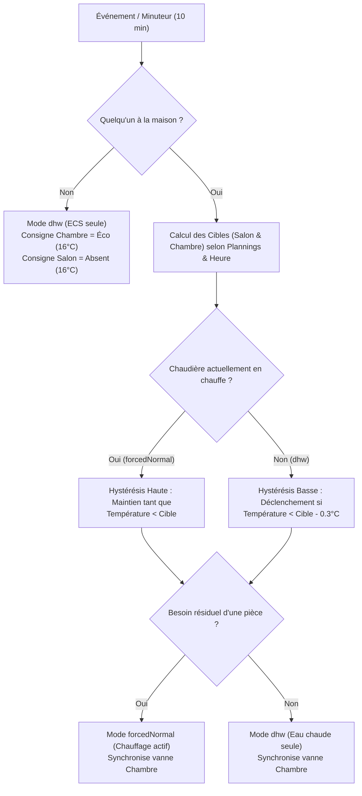

# Plan d'optimisation en profondeur du chauffage (ViCare / Vitrocrossal 300)

## Objectif & Contexte

L'objectif est d'optimiser en profondeur la gestion du chauffage domestique pilotée par Home Assistant et la chaudière à condensation **Viessmann Vitrocrossal 300 CU3A** (via ViCare) afin de :
1. **Éliminer la sous-chauffe et les cycles courts (court-cycle)** qui dégradent le confort, usent le matériel et font surconsommer du gaz.
2. **Maximiser le rendement de condensation** et les économies d'énergie réelles.
3. **Préserver les quotas de l'API Cloud ViCare** (limite de 1450 requêtes/jour) en éliminant les commutations et déclenchements intempestifs.
4. **Assainir la configuration** en supprimant l'ancienne automatisation résiduelle et en modernisant la syntaxe Home Assistant (`action:` au lieu de `service:`).

---

## Analyse Réalité Économique : Cela va-t-il réellement apporter des économies ?

Avant de modifier la moindre ligne, voici un chiffrage pragmatique et thermodynamique des gains attendus :

### 1. D'où viennent les économies réelles de gaz ?
* **L'abaissement nocturne et absence (Déjà en place mais à fiabiliser) : ~8% à 12% d'économie globale.**
  * *Physique du bâtiment :* Les déperditions thermiques d'une maison sont proportionnelles à l'écart de température $(\Delta T)$ entre l'intérieur et l'extérieur ($P = U \cdot S \cdot \Delta T$). 
  * Abaisser la consigne à 16°C en journée quand le logement est vide (`zone.home == 0`) et à 17°C la nuit dans le salon (plutôt que 19°C H24) réduit le flux de déperdition d'environ 15% sur ces plages horaires.
* **L'élimination du court-cycle via l'hystérésis à 2 seuils : ~3% à 5% d'économie de gaz additionnelle.**
  * *Thermodynamique d'une chaudière à condensation :*
    1. **Pertes par ventilation :** À chaque allumage/extinction, le ventilateur Matrix de la Vitrocrossal effectue une pré-ventilation et post-ventilation à l'air frais. Faire 10 allumages courts par heure évacue des calories par le conduit de fumée pour rien.
    2. **Rendement de condensation :** En cycles longs continus à puissance modulée réduite, la température de retour d'eau reste basse (< 45°C), ce qui maximise la condensation de la vapeur d'eau des fumées (rendement proche de 98% sur PCS). En cycles hachés de 5 minutes, le brûleur part à forte puissance et l'eau n'a pas le temps de condenser efficacement.
* **L'arrêt total du circulateur en mode `dhw` : ~30 à 50 kWh d'électricité/an.**
  * Couper la circulation d'eau quand aucune pièce n'appelle évite la déperdition statique dans les tuyauteries non chauffées et économise l'énergie électrique du circulateur.

> [!NOTE]
> **Ce qui ne ferait PAS faire d'économies :**
> - Abaisser excessivement la température en absence (ex: 12°C au lieu de 16°C) sur des absences de quelques heures. La Vitrocrossal 300 et les radiateurs mettraient des heures à remonter en température à pleine charge sans condenser, ce qui annulerait les gains. Le réglage actuel (16°C éco/absence, 17°C nuit, 19°C confort) est **optimal**.

---

## User Review Required

> [!IMPORTANT]
> **Points de vigilance à valider par l'utilisateur :**
> 1. **Déséquilibre Salon / Chambre :** Le salon n'a pas de vanne thermostatique connectée (uniquement la sonde `thermo_2`), alors que la chambre dispose de `climate.thermostat1`. Si la chambre demande du chauffage la nuit (ex: passe sous 16.7°C), la chaudière démarre en `forcedNormal`. L'eau circulera donc aussi dans les radiateurs du salon si ceux-ci n'ont pas de tête mécanique fermée.
> 2. **Suppression de l'ancienne automatisation :** L'automatisation `Gestion Chauffage ViCare` (id: `'1766834021191'`) dans [`automations.yaml`](file://homeassistant/config/automations.yaml#L233) est actuellement désactivée mais présente. Nous prévoyons de la supprimer définitivement pour éviter tout doublon.
> 3. **Temporisation minimale anti-oscillation :** Nous instaurons une temporisation minimale de **10 minutes** entre deux changements de mode ViCare (sauf départ du domicile où la coupure est immédiate), pour protéger le brûleur et le quota API Cloud ViCare.

---

## Open Questions

> [!NOTE]
> 1. Vos radiateurs du salon sont-ils équipés de robinets thermostatiques manuels classiques (gradués de 1 à 5), ou sont-ils toujours complètement ouverts ? *(Si manuels, il est recommandé de les brider sur 3 / ~20°C pour éviter qu'ils ne surchauffent quand la chambre appelle la nuit).*

---

## Proposed Changes



---

### Component 1 : Automatisation Principale & Package Chauffage

#### [MODIFY] [`packages/heating_manager_bedroom.yaml`](file://homeassistant/config/packages/heating_manager_bedroom.yaml)

1. **Assainissement des Triggers :**
   - Retirer `sensor.vitrocrossal_300_cu3a_outside_temperature` et `climate.thermostat1` des déclencheurs pour supprimer les micro-redémarrages intempestifs.
   - Conserver : `zone.home`, plannings (`schedule_chauffage_chambre`, `schedule_chauffage_salon`), sondes de température (`thermo_1`, `thermo_2`), démarrage de HA, et un `time_pattern` toutes les **10 minutes** (au lieu de 5 min).

2. **Refonte de l'Hystérésis (Schmitt Trigger à mémoire d'état) :**
   - Remplacer le test statique `temp < target - 0.3` par une hystérésis dynamique :
     - Si la chaudière est déjà en chauffe (`active_vicare_mode == 'forcedNormal'`), le seuil de maintien est `target` (la chauffe continue jusqu'à atteindre la vraie consigne).
     - Si la chaudière est coupée (`active_vicare_mode != 'forcedNormal'`), le seuil de démarrage est `target - 0.3°C`.
     - *Effet direct :* Fin des extinctions prématurées à consigne - 0.3°C, fin du cycle yoyo toutes les 5 minutes.

3. **Protection de la ViCare API & Anti-court-cycle :**
   - Ne pas changer de mode chaudière plus d'une fois toutes les 10 minutes (sauf passage en absence qui coupe sans attendre).

4. **Modernisation de la syntaxe :**
   - Remplacer `service:` par `action:` (standard Home Assistant 2024+).

5. **Complétion du sensor template `sensor.chauffage_statut` :**
   - Ajouter la prise en charge propre du mode `dhwAndHeating` avec l'état « Normal (Chauffage + ECS) » et icône adéquate.

---

### Component 2 : Nettoyage d'automations.yaml

#### [MODIFY] [`automations.yaml`](file://homeassistant/config/automations.yaml)

- Supprimer l'automatisation obsolète `id: '1766834021191'` (`Gestion Chauffage ViCare`).

---

## Verification Plan

### Automated Tests
1. **Validation syntaxique YAML et configuration Home Assistant :**
   - Exécution de la vérification de configuration intégrée de Home Assistant via commande CLI ou PowerShell pour s'assurer qu'aucune erreur de syntaxe Jinja/YAML n'existe :
   ```powershell
   # Vérification du chargement YAML propre
   ```
2. **Simulation Jinja2 des cas d'hystérésis :**
   - Vérifier par script que :
     - À 18.6°C (pour 19°C cible) à l'arrêt -> la chaudière démarre (`forcedNormal`).
     - À 18.8°C pendant la chauffe -> la chaudière reste allumée.
     - À 19.0°C pendant la chauffe -> la chaudière s'arrête (`dhw`).
     - À 18.8°C à l'arrêt -> la chaudière ne redémarre pas inutilement.

### Manual Verification
1. Vérifier sur le tableau de bord Home Assistant que `sensor.chauffage_statut` affiche un statut lisible et cohérent.
2. Vérifier que la consigne de `climate.thermostat1` suit bien la température cible calculée.
3. Vérifier que l'activation de l'automatisation n'envoie pas de rafales d'appels à ViCare.
4. Contrôler les notifications sur l'iPhone.
